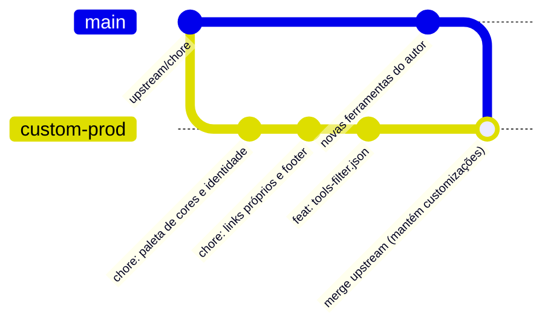

# Guia de Customização, Deploy, Segurança e Atualizações Contínuas: IT-Tools

Este documento descreve como customizar o **IT-Tools**, publicá-lo em seu próprio servidor/domínio, implementar controles de segurança contra abusos e manter um fluxo sustentável de recebimento de atualizações do desenvolvedor original via Git.

---

## 1. 🧠 Arquitetura: O que realmente consome recursos?

O **IT-Tools é uma Single Page Application (SPA) que roda 100% no navegador do usuário** (utilizando JavaScript e WebAssembly):
* **Cálculos, conversões, criptografia, leituras de imagem e formatações:** tudo isso usa a CPU e a memória do visitante/cliente, **não do seu servidor**.
* **O papel do seu servidor:** apenas servir arquivos estáticos (HTML, JS, CSS, WASM, ícones). Não existe um backend dinâmico processando tarefas pesadas a cada clique.

---

## 2. 🎨 Implementando as Customizações Desejadas

### A. Ocultar ou Filtrar Ferramentas (Sem alterar o código-fonte)
O projeto suporta nativamente a inclusão/exclusão de categorias ou ferramentas via expressões regulares no arquivo `tools-filter.json`:
```json
{
  "excludeCategoryFilterRegex": "^(Gaming|Maths|Physics)$",
  "excludeToolsFilterRegex": "ai-prompt-splitter|outro-slug"
}
```
* **No ambiente local/build:** adicione o arquivo em `public/tools-filter.json`.
* **No Docker:** monte o arquivo como volume no contêiner em `/usr/share/nginx/html/tools-filter.json`.

### B. Alterar a Paleta de Cores e Identidade Visual
* **Cores dos temas (Claro e Escuro):** edite `src/themes.ts`. Altere variáveis como `primaryColor`, `primaryColorHover`, `bodyColor` e os estilos de menus e cards do Naive UI.
* **Gradiente e Logo na Barra Lateral:** edite ou substitua `src/assets/hero-gradient.svg` e o texto do logo em `src/layouts/base.layout.vue`.
* **Estilos utilitários:** personalize regras globais e tipografia em `unocss.config.ts`.

### C. Substituir Links, Autoria e Redes Sociais
* **Botão do GitHub na barra superior:** em `src/components/NavbarButtons.vue`, troque a URL de destino para o seu perfil/repositório ou substitua pelo link do seu site.
* **Rodapé (Footer):** em `src/layouts/base.layout.vue`, altere os links de copyright e versão para referenciar seus próprios canais.
* **Meta Tags, Título e Favicon:** altere `index.html` (`<title>`, `<meta name="description">`) e os favicons na pasta `public/`.
* **Conteúdo personalizado na Home:** crie um arquivo `home.custom.md` (na raiz do deploy ou montado no Docker) para exibir avisos ou textos personalizados na página inicial.

---

## 3. 🛡️ Segurança e Rate Limiting no Servidor

Como a aplicação é estática, o principal risco de abuso é o consumo excessivo de banda por scrapers ou downloads contínuos de arquivos grandes (como módulos WebAssembly e pacotes de OCR de 10 a 25 MB).

### Opção A: Nginx (Reverse Proxy)
Adicione regras de limitação de requisições e conexões por IP no Nginx de borda:
```nginx
# Limite de 20 requisições por segundo por IP (zona de 10 MB)
limit_req_zone $binary_remote_addr zone=tools_limit:10m rate=20r/s;
limit_conn_zone $binary_remote_addr zone=addr_limit:10m;

server {
    server_name tools.seusite.com;

    # Limita conexões simultâneas por IP
    limit_conn addr_limit 15;

    location / {
        limit_req zone=tools_limit burst=40 nodelay;
        proxy_pass http://127.0.0.1:8080; # Aponta para o contêiner do it-tools
        proxy_set_header Host $host;
        proxy_set_header X-Real-IP $remote_addr;
        proxy_set_header X-Forwarded-For $proxy_add_x_forwarded_for;
    }
}
```

### Opção B: Cloudflare (Altamente Recomendado)
Colocar o domínio ou subdomínio atrás do proxy da Cloudflare oferece duas grandes vantagens:
1. **Edge Caching:** a CDN armazena em cache todos os arquivos JS, CSS e WASM. O usuário baixa diretamente da borda da Cloudflare, poupando a banda e o processamento do seu servidor.
2. **WAF & Rate Limiting Rules:** bloqueio automatizado de bots maliciosos, crawlers indesejados e ataques DDoS.

---

## 4. 🌐 Deploy e Vinculação ao Domínio

Existem dois cenários principais de hospedagem:

### 1. Em um subdomínio dedicado (Recomendado)
* **Exemplo:** `https://tools.seusite.com`
* Basta apontar a entrada DNS A/CNAME para o seu servidor e rodar o contêiner Docker na porta padrão (`8080`).

### 2. Em um subdiretório do site principal
* **Exemplo:** `https://seusite.com/tools/`
* O contêiner já possui suporte dinâmico para subpastas sem necessidade de recompilar. Basta passar a variável `BASE_URL`:
```yaml
services:
  it-tools:
    image: sharevb/it-tools:latest
    environment:
      - BASE_URL=/tools/
    ports:
      - "8080:8080"
```

---

## 5. 🔄 Estratégia Git para Atualizações Contínuas (Upstream Workflow)

Para receber correções e novas ferramentas criadas pelo autor sem perder suas personalizações:



### Passo a Passo no Terminal:

1. **Adicionar o repositório original como `upstream`:**
   ```bash
   git remote add upstream https://github.com/sharevb/it-tools.git
   ```

2. **Criar sua branch de produção isolada:**
   ```bash
   git checkout -b custom-prod
   ```

3. **Registrar suas alterações em commits atômicos:**
   * Commit 1: `chore: customização de paleta e temas`
   * Commit 2: `chore: substituição de links de autor e rodapé`

4. **Para puxar e mesclar novas atualizações do autor:**
   ```bash
   # 1. Baixar os commits mais recentes do upstream
   git fetch upstream

   # 2. Garantir que está na sua branch customizada
   git checkout custom-prod

   # 3. Mesclar as novidades
   git merge upstream/chore/all-my-stuffs
   ```

> [!TIP]
> Priorize usar os arquivos de configuração externa (`tools-filter.json`, `home.custom.md`, `external-tools.json`), pois eles ficam fora do código-fonte versionado dos componentes Vue e **nunca geram conflitos de merge** durante atualizações.
