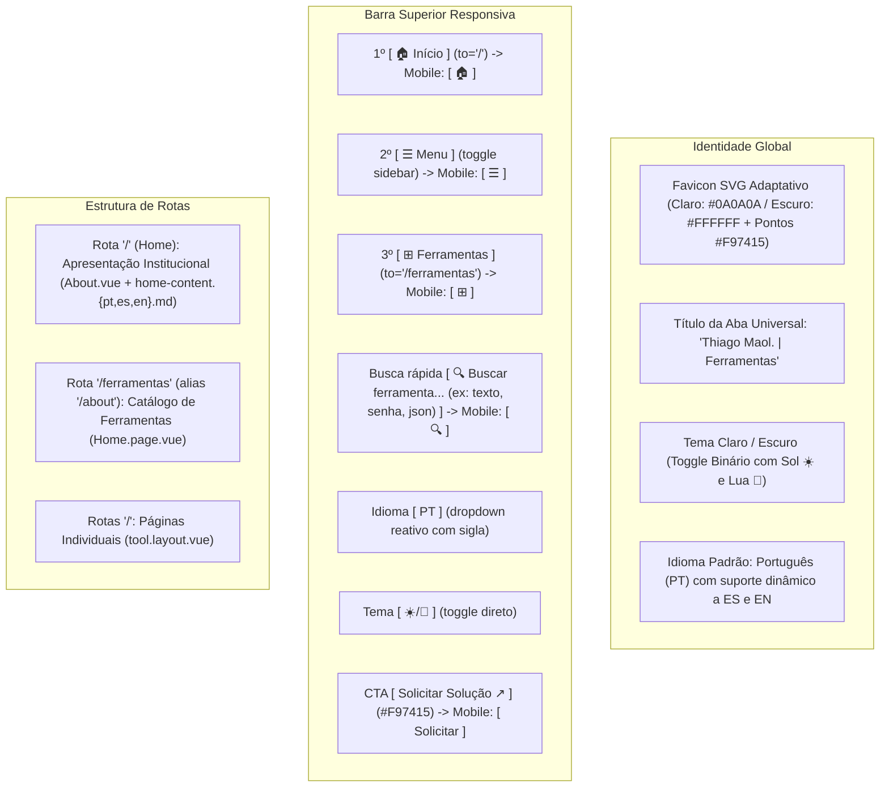

# Baseline Arquitetural e Diretrizes de Rebranding — IT-Tools (Thiago Maol)

Este documento registra o estado exato da aplicação, todas as convenções estabelecidas, a arquitetura de UX/UI lapidada e as restrições estritas do ambiente, servindo de base sólida para o "eu do futuro" aplicar o **UI Playbook** sem quebrar nenhuma funcionalidade, rota ou harmonia visual conquistada.

---

## 1. Restrições Críticas de Ambiente e Governança

> [!CAUTION] Restrição Absoluta de Hardware (Host com 2 CPUs)
> - **Proibição de Comandos Pesados:** É TERMINANTEMENTE PROIBIDO executar `pnpm build`, `vite build`, `pnpm typecheck`, `vue-tsc` e `pnpm test:e2e` na máquina local. Esses processos travam o kernel e congelam o host.
> - **Verificação Local Permitida:** Apenas linters estáticos pontuais: `pnpm oxlint <arquivo>`.
> - **Execução Estritamente Sequencial:** Sem comandos em segundo plano (*background tasks*), processos concorrentes ou timers automáticos (`schedule`).
> - **Builds de Produção:** Exclusividade de esteiras remotas de CI/CD (GitHub Actions).

### Governança Git e DevLog
- **Branch de Trabalho:** `custom-prod` (trabalho puramente local, sem push automático).
- **Proibido Commit/Push Automático:** Sempre apresentar proposta formal (Conventional Commit em tópicos e indicação de commit local) e aguardar autorização explícita do usuário.
- **Governança de DevLog (`DEVLOG.md`):** Decisões arquiteturais estruturantes, mudanças conceituais ou novos trade-offs exigem entrada datada contendo estritamente: `1. Contexto`, `2. Decisão`, `3. Justificativa (Por quê)` e `4. Consequências / Trade-offs`.
- **Diretório `pessoal/`:** Anotações e manifestos do autor. Não ler, indexar ou resumir sem solicitação explícita do usuário.

---

## 2. Mapa do Estado Atual da UI e Roteamento (A Preservar)

### A. Cabeçalho e Identidade Visual da Marca
- **Logotipo Vetorial:** [src/brand/logo/](file:///mnt/dados/home/thiago/PROJETOS/ghub_org_thiagomaol-com-br/it-tools/src/brand/logo/)
  - Modo Claro: [logo-gradient-light.svg](file:///mnt/dados/home/thiago/PROJETOS/ghub_org_thiagomaol-com-br/it-tools/src/brand/logo/logo-gradient-light.svg) (Gradiente 135° de `#F97415` a `#FAC49E`).
  - Modo Escuro: [logo-gradient-dark.svg](file:///mnt/dados/home/thiago/PROJETOS/ghub_org_thiagomaol-com-br/it-tools/src/brand/logo/logo-gradient-dark.svg) (Gradiente 135° de `#F9771A` a `#FBA66A`).
  - Alternância dinâmica em [base.layout.vue](file:///mnt/dados/home/thiago/PROJETOS/ghub_org_thiagomaol-com-br/it-tools/src/layouts/base.layout.vue) via `styleStore.isDarkTheme`.
  - Configuração do Vite (`vite.config.ts`): `removeViewBox: false`, `cleanupIds: false` e `convertPathData: false` no `svgLoader` para evitar colisão de IDs e corte vetorial.

### B. Barra Superior de Navegação (Desktop e Mobile)
- **Desktop:**
  - `[ 🏠 Início ]` (`round variant="text" font-semibold`, link `/`).
  - `[ ☰ Menu ]` (`round variant="text" font-semibold`, aciona `styleStore.isMenuCollapsed`).
  - `[ ⊞ Ferramentas ]` (`round variant="text" font-semibold`, link `/ferramentas`, ícone `LayoutGrid`).
  - Campo de busca `[ 🔍 Buscar ferramenta... (ex: texto, senha, json) ]` com `:aria-label="... - Atalho: Ctrl + K"`.
  - Seletor de Idioma `[ PT ]` (sigla dinâmica em caixa alta com dropdown das línguas).
  - Alternador de Tema `[ ☀️ / 🌙 ]` (toggle binário com tooltip dinâmico "Mudar para modo claro/escuro").
  - Botão de Ação `[ Solicitar Solução ↗ ]` em laranja `#F97415` apontando para `https://thiagomaol.com.br/solicitar-solucao/`.
- **Mobile (<= 700px):**
  - Todos os 4 primeiros botões viram ícones circulares compactos (`[ 🏠 ]`, `[ ☰ ]`, `[ ⊞ ]`, `[ 🔍 ]`), mantendo `[ PT ]`, `[ ☀️/🌙 ]` e `[ Solicitar ]` em uma única linha sem quebra.

### C. Página Inicial (`/`) — Apresentação Institucional
- Arquivo: [About.vue](file:///mnt/dados/home/thiago/PROJETOS/ghub_org_thiagomaol-com-br/it-tools/src/pages/About.vue).
- Conteúdo: Importa diretamente Markdown via `?raw` ([home-content.pt.md](file:///mnt/dados/home/thiago/PROJETOS/ghub_org_thiagomaol-com-br/it-tools/src/pages/home-content.pt.md), [home-content.es.md](file:///mnt/dados/home/thiago/PROJETOS/ghub_org_thiagomaol-com-br/it-tools/src/pages/home-content.es.md) e [home-content.en.md](file:///mnt/dados/home/thiago/PROJETOS/ghub_org_thiagomaol-com-br/it-tools/src/pages/home-content.en.md)), evitando erros de compilação do i18n com o e-mail `thiagomaol@gmail.com`.
- Estilização Rica:
  - `.icon-badge--danger` (vermelho translúcido com SVG de 'X' para problemas/gargalos).
  - `.icon-badge--success` (verde translúcido com SVG de check para entregas técnicas).
  - `.icon-badge--step` (laranja institucional com numeração para etapas de contato).
  - `<kbd>` estilizados e `<blockquote>` com borda lateral `#F97415`.

### D. Página de Catálogo de Ferramentas (`/ferramentas` + alias `/about`)
- Arquivo: [Home.page.vue](file:///mnt/dados/home/thiago/PROJETOS/ghub_org_thiagomaol-com-br/it-tools/src/pages/Home.page.vue).
- Topo da página possui 2 caixas retráteis com abertura por clique no cabeçalho ou botão "Expandir/Recolher":
  1. **"Importar e Exportar Favoritos"**: grade responsiva de 2 colunas com exportação de JSON e importação.
  2. **"Todas as 474 ferramentas em tabela"**: montagem condicional (`v-if="isAllToolsOpen"`) que poupa memória e acelera o carregamento inicial.
- Abaixo das caixas: Vitrine de cards com seção de ferramentas favoritas (drag & drop), mais recentes e listagem geral.

### E. Internacionalização e Collação Alfabética
- Arquivo: [i18n.plugin.ts](file:///mnt/dados/home/thiago/PROJETOS/ghub_org_thiagomaol-com-br/it-tools/src/plugins/i18n.plugin.ts).
- `ptBaseMessages` empacotado de forma síncrona/eager no boot ao lado do inglês.
- `DEFAULT_LOCALE = 'pt'`.
- Configurado `"default_locale": "pt"` em [public/tools-settings.json](file:///mnt/dados/home/thiago/PROJETOS/ghub_org_thiagomaol-com-br/it-tools/public/tools-settings.json).
- Categorias corrigidas em [locales/pt.yml](file:///mnt/dados/home/thiago/PROJETOS/ghub_org_thiagomaol-com-br/it-tools/locales/pt.yml):
  - `web`: **Web** (separada de Rede).
  - `network`: **Rede**.
  - `markdown`: **Markdown** (eliminando "Redução de preço").
  - `finance`: **Finanças** (eliminando "Financiar").
- Ordenação alfabética com `Intl.Collator` em [tools.store.ts](file:///mnt/dados/home/thiago/PROJETOS/ghub_org_thiagomaol-com-br/it-tools/src/tools/tools.store.ts) e [Home.page.vue](file:///mnt/dados/home/thiago/PROJETOS/ghub_org_thiagomaol-com-br/it-tools/src/pages/Home.page.vue), corrigindo a posição de termos acentuados (*"Códigos de barras"* e *"Física"*).

---

## 3. Diretrizes para o Rebranding com o UI Playbook

Ao receber o material do UI Playbook para harmonizar o visual com o site oficial:
1. **Preservar a Estrutura Funcional:** Não quebrar a lógica das rotas (`/` e `/ferramentas`), a sincronização de idiomas ou a montagem lazy das ferramentas.
2. **Harmonização de Cores e Tokens:** Aplicar paletas, tipografia, raios de borda (`border-radius`), sombras e fundos especificados no Playbook mantendo a coerência entre modo claro e escuro.
3. **Validação Contínua:** Validar cada arquivo modificado com `pnpm oxlint <arquivo>` e inspecionar no servidor dev antes de propor o commit.
4. **Governança Estrita:** Seguir o ciclo de proposta formal de commit e DevLog caso ocorram mudanças arquiteturais.
